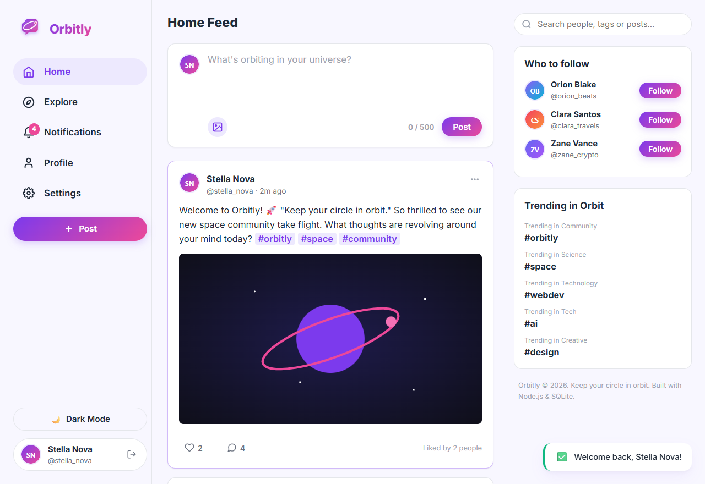
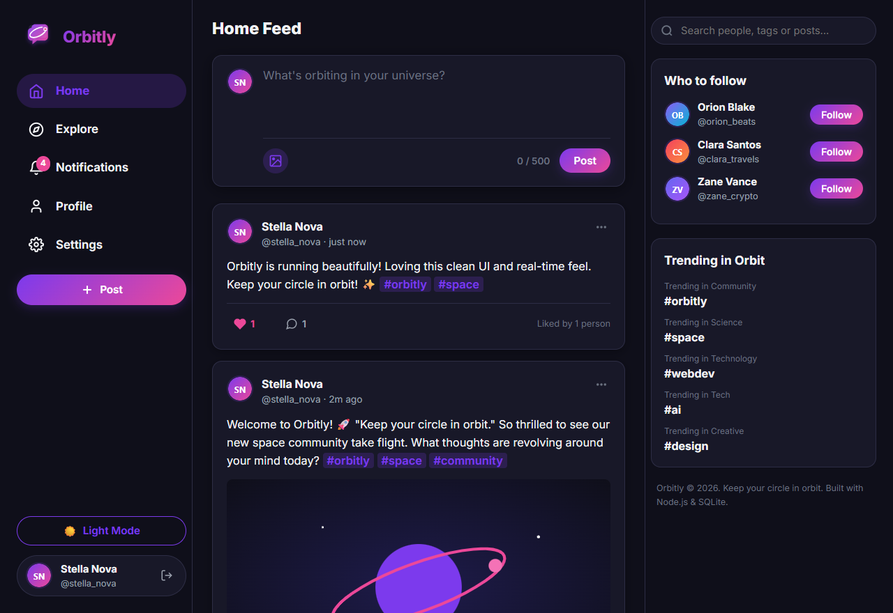
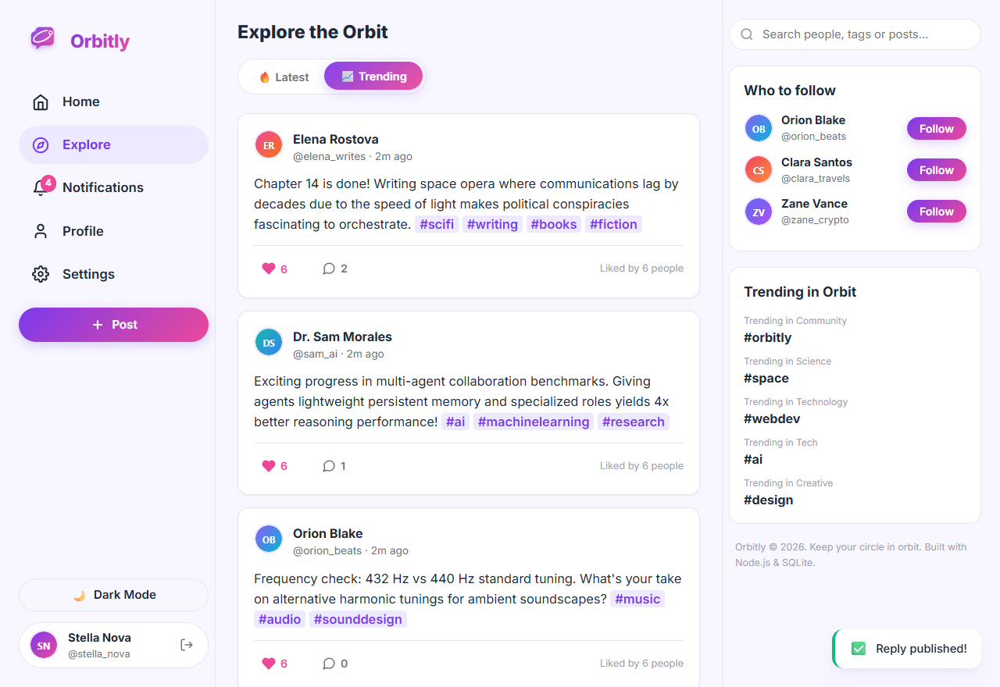
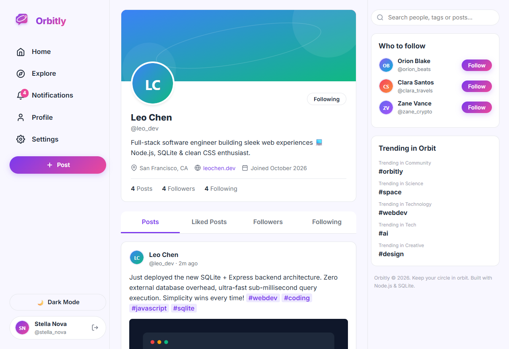
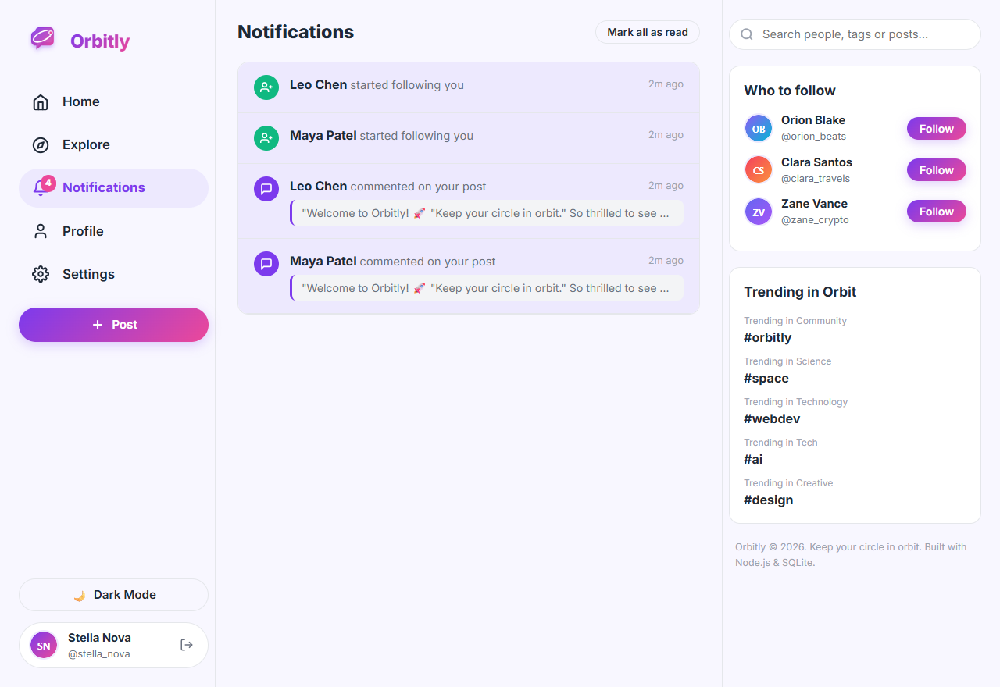
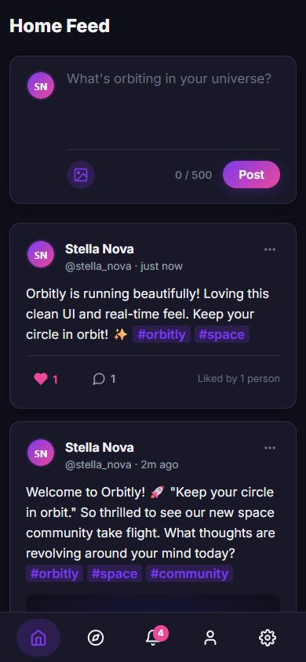

# 🪐 Orbitly

> **"Keep your circle in orbit."**

Orbitly is a production-quality, high-performance mini social media web application built with Node.js, Express, SQLite, and vanilla JavaScript. Designed with a clean 3-column layout, deep cosmic dark mode, optimistic UI interactions, live debounced search, nested replies, and comprehensive security controls.

---

## 📸 Screenshots

| Light Mode (Home Feed) | Dark Mode (Home Feed) |
| :---: | :---: |
|  |  |

| Explore & Trending | Profile & Customisation |
| :---: | :---: |
|  |  |

| Interactive Notifications | Mobile Responsive View |
| :---: | :---: |
|  |  |

---

## ✨ Features

### 1. Authentication & Session Management
- **Registration**: Username (alphanumeric, 3–20 chars), email, display name, password (minimum 6 chars), and confirmation check with real-time feedback.
- **Login & Logout**: Secure cookie-based sessions with SQLite session store persistence.
- **"Remember Me"**: Extends session lifetime to 30 days.
- **Password Management**: Change password with current password verification.
- **Access Control**: Authentication enforced on all mutating routes and feed endpoints.

### 2. User Profiles (`/u/:username`)
- Customizable profile header with avatar, banner cover, bio, location, personal website, and joined date.
- Real-time counts for posts, followers, and following.
- Interactive tabs: **Posts**, **Liked posts**, **Followers**, and **Following**.
- Live Follow / Unfollow button with instant counter updates.
- Modal editor for updating display name, bio, location, website, avatar, and banner.

### 3. Posts & Hashtag Discovery
- Post composer with live 500-character countdown counter and optional image attachment (up to 5 MB).
- Clickable `#hashtags` automatically link to `/tag/:name` tag explore streams.
- Edit and delete own posts with modal confirmation.
- Relative timestamps ("just now", "2m ago") and an `edited` badge.
- Optimistic UI updates with zero page reloads.

### 4. Nested Comments & Comment Likes
- Full comment threads on every post with 1-level deep nested replies.
- Comment likes with instant heart toggling and counters.
- Permission enforcement: comment authors can delete their own comments; post owners can delete any comment on their post.

### 5. Optimistic Like System
- Animated heart icon with micro-pulse keyframe animation.
- Instant counter update with automatic rollback on network failure.
- "Liked by" modal listing users who liked the post.
- Database `UNIQUE(user_id, post_id)` and `UNIQUE(user_id, comment_id)` constraints prevent duplicate likes.

### 6. Follow Graph & Suggestions
- Follow/unfollow without reload, updating both cards and profile metrics live.
- SQLite `CHECK(follower_id != following_id)` constraint and API checks block self-following.
- Dedicated "Who to follow" sidebar ranking accounts you don't follow yet by follower count.

### 7. Feeds & Discovery
- **Home Feed**: Real-time chronological stream of posts from accounts you follow plus your own.
- **Explore Feed**: All platform posts with a **Latest** vs. **Trending** toggle (Trending ranks by likes in the last 7 days).
- **Search**: Live debounced (300 ms) search suggestions for users, hashtags, and posts. Full search view at `/search?q=...`.

### 8. Notifications
- Automated notifications dispatched when someone likes your post, comments, replies, or follows you (self-actions are excluded).
- Notification bell in navbar with live unread badge polling every 30 seconds.
- Notifications view with "Mark as read" upon clicking and "Mark all as read" button.

### 9. Extras & UX Polish
- **Dark Mode**: High-contrast theme (#0F0F1A background with soft purple elevations) persisted in `localStorage`.
- **Responsive Layout**: Desktop 3-column layout, tablet streamlined view, and mobile bottom navigation bar.
- **Toast Notifications**: Floating animated toast alerts for success, errors, and system feedback.
- **Skeleton Loaders**: Smooth pulsing skeletons during content fetching.

---

## 🛠️ Tech Stack & Architecture

- **Backend**: Node.js 20+ with Express.js 4
- **Database**: SQLite via `better-sqlite3` and Node 22+ built-in `node:sqlite` fallback with WAL mode and `PRAGMA foreign_keys = ON;`.
  - All SQL queries are encapsulated in a database repository layer (`src/db/queries.js`) using single-query JOINs and aggregations to prevent N+1 queries.
- **Authentication**: `express-session` with a custom SQLite session store (`sessions` table) and `bcryptjs` (12 rounds) for password hashing.
- **File Uploads**: `multer` storing files in `uploads/` with UUID-based randomized filenames, strictly validating image MIME types (JPEG, PNG, WebP, GIF) and 5 MB size limits.
- **Security**:
  - `helmet` with custom Content Security Policy (allowing Google Fonts & SVG avatars)
  - `express-rate-limit` (stricter limit on `/api/auth/login` and `/api/auth/register`)
  - Double-submit CSRF protection with `X-CSRF-Token` headers for mutating requests
  - `express-validator` schema validations & sanitization
  - XSS prevention (vanilla DOM construction with `textContent` / sanitized HTML nodes)
- **Frontend**: Vanilla JavaScript SPA with History API router (`router.js`), CSS3 custom properties, flexbox/grid, and zero external frontend dependencies.
- **Testing**: Jest + Supertest test suite with 32 unit and integration tests.

---

## 🚀 Quickstart & Setup

### 1. Prerequisites
- **Node.js**: v20 or higher
- **npm**: v9 or higher

### 2. Installation
```bash
# Clone or navigate to the repository
cd "d:/CodeAlpha/Social Media Platform"

# Install dependencies
npm install
```

### 3. Environment Configuration
Copy `.env.example` to create `.env`:
```bash
# Windows PowerShell
Copy-Item .env.example .env

# macOS / Linux
cp .env.example .env
```

Default configuration in `.env`:
```env
PORT=3000
NODE_ENV=development
SESSION_SECRET=orbitly-super-secret-key-change-in-production-12345
UPLOAD_DIR=uploads
```

### 4. Database Initialization & Seeding
Populate the database with 8 demo users, 30 posts, nested comments, likes, and follows:
```bash
npm run seed
```

### 5. Running the Application
```bash
# Start in development mode with nodemon
npm run dev

# Or start in standard production mode
npm start
```
Open **http://localhost:3000** in your browser to start exploring Orbitly!

---

## 👥 Demo User Accounts

All demo accounts use the password: **`demo1234`**

| Username | Display Name | Role / Bio |
| :--- | :--- | :--- |
| `stella_nova` | **Stella Nova** | Astrophysicist & stargazer 🌌 |
| `leo_dev` | **Leo Chen** | Full-stack software engineer (Node.js & SQLite) 💻 |
| `maya_design` | **Maya Patel** | Product designer & visual architect 🎨 |
| `orion_beats` | **Orion Blake** | Synthesizer wizard & electronic producer 🎧 |
| `elena_writes` | **Elena Rostova** | Sci-fi author & espresso fanatic ☕ |
| `sam_ai` | **Dr. Sam Morales** | AI researcher & robotics explorer 🤖 |
| `clara_travels` | **Clara Santos** | Documentary photographer & digital nomad 📸 |
| `zane_crypto` | **Zane Vance** | Security researcher & open-source contributor 🛡️ |

---

## 🧪 Running Automated Tests

Run the full Jest test suite:
```bash
npm test
```

Test coverage includes:
- **Authentication**: Registration unique constraints, password validation, session login, password change, logout.
- **Posts**: Creation, 500-char limits, hashtag extraction, ownership edit/delete checks (403 for unauthorized users).
- **Comments**: Top-level comments, 1-level deep replies, comment likes, deletion permissions for authors and post owners.
- **Follow System**: Following, unfollowing, self-follow blocked by constraint (`CHECK(follower_id != following_id)`), feed integration.
- **Security & Permissions**: 401 Unauthorized verification on protected routes, 404 JSON response formatting.

---

## 📡 REST API Summary

All endpoints are prefixed with `/api` and exchange JSON.

### Authentication (`/api/auth`)
| Method | Endpoint | Description | Auth Required |
| :--- | :--- | :--- | :---: |
| `POST` | `/api/auth/register` | Register new user | No |
| `POST` | `/api/auth/login` | Log in user and establish session | No |
| `POST` | `/api/auth/logout` | Destroy session and clear cookie | Yes |
| `POST` | `/api/auth/change-password` | Update user password | Yes |
| `GET` | `/api/auth/me` | Fetch currently authenticated user | No |

### Users & Profiles (`/api/users`)
| Method | Endpoint | Description | Auth Required |
| :--- | :--- | :--- | :---: |
| `GET` | `/api/users/suggestions` | Suggested users to follow | Yes |
| `PUT` | `/api/users/me` | Update profile bio, avatar, banner (multipart) | Yes |
| `GET` | `/api/users/:username` | Get profile and stats | No |
| `GET` | `/api/users/:username/posts` | Get posts by user | No |
| `GET` | `/api/users/:username/liked` | Get posts liked by user | No |
| `GET` | `/api/users/:username/followers`| Get user followers | No |
| `GET` | `/api/users/:username/following`| Get users followed by user | No |
| `POST` | `/api/users/:username/follow` | Follow a user | Yes |
| `DELETE`| `/api/users/:username/follow` | Unfollow a user | Yes |

### Posts (`/api/posts`)
| Method | Endpoint | Description | Auth Required |
| :--- | :--- | :--- | :---: |
| `GET` | `/api/posts/feed` | Get chronological home feed | Yes |
| `GET` | `/api/posts/explore?sort=latest\|trending` | Explore all posts | No |
| `GET` | `/api/posts/tag/:name` | Get posts by hashtag | No |
| `GET` | `/api/posts/:id` | Get post details | No |
| `POST` | `/api/posts` | Create new post (multipart for image) | Yes |
| `PUT` | `/api/posts/:id` | Edit post content (owner only) | Yes |
| `DELETE`| `/api/posts/:id` | Delete post (owner only) | Yes |
| `POST` | `/api/posts/:id/like` | Like post | Yes |
| `DELETE`| `/api/posts/:id/like` | Unlike post | Yes |
| `GET` | `/api/posts/:id/likes` | Get users who liked post | No |
| `GET` | `/api/posts/:id/comments` | Get comments with nested replies | No |
| `POST` | `/api/posts/:id/comments` | Add comment or nested reply | Yes |

### Comments (`/api/comments`)
| Method | Endpoint | Description | Auth Required |
| :--- | :--- | :--- | :---: |
| `DELETE`| `/api/comments/:id` | Delete comment (author or post owner) | Yes |
| `POST` | `/api/comments/:id/like` | Like a comment | Yes |
| `DELETE`| `/api/comments/:id/like` | Unlike a comment | Yes |

### Search & Notifications (`/api/search`, `/api/notifications`)
| Method | Endpoint | Description | Auth Required |
| :--- | :--- | :--- | :---: |
| `GET` | `/api/search?q=&type=` | Live search users and posts | No |
| `GET` | `/api/notifications` | Get user notifications | Yes |
| `GET` | `/api/notifications/unread-count`| Get unread notifications count | Yes |
| `POST` | `/api/notifications/:id/read` | Mark single notification as read | Yes |
| `POST` | `/api/notifications/read-all` | Mark all notifications as read | Yes |

---

## 📂 Project Structure

```
orbitly/
├── package.json               # Scripts (start, dev, seed, test, lint)
├── README.md                  # Comprehensive documentation
├── .env.example               # Environment template
├── .gitignore                 # Ignored files (uploads, node_modules, data)
├── server.js                  # Application setup & middlewares
├── src/
│   ├── config/                # env, session, multer
│   ├── db/                    # connection adapter, schema.sql, queries.js, seed.js
│   ├── middleware/            # auth, csrf, validate, errorHandler
│   ├── controllers/           # auth, users, posts, comments, search, notifications
│   ├── routes/                # route definitions
│   ├── services/              # hashtag, notification, feed services
│   └── utils/                 # time formatters, sanitizers
├── public/
│   ├── css/                   # base.css, components.css, dark.css
│   ├── js/                    # api.js, router.js, app.js
│   │   ├── components/        # toast.js, modal.js, postCard.js, commentItem.js
│   │   └── views/             # feed, explore, postDetail, profile, notifications, search, auth, settings
│   ├── img/                   # logo.svg, favicon.svg
│   ├── screenshots/           # visual UI captures
│   └── index.html             # Responsive 3-column shell
├── uploads/                   # User images and avatars
└── tests/                     # 32 Jest & Supertest test cases
```

---

## 📜 License
MIT License. Orbitly - Keep your circle in orbit.
